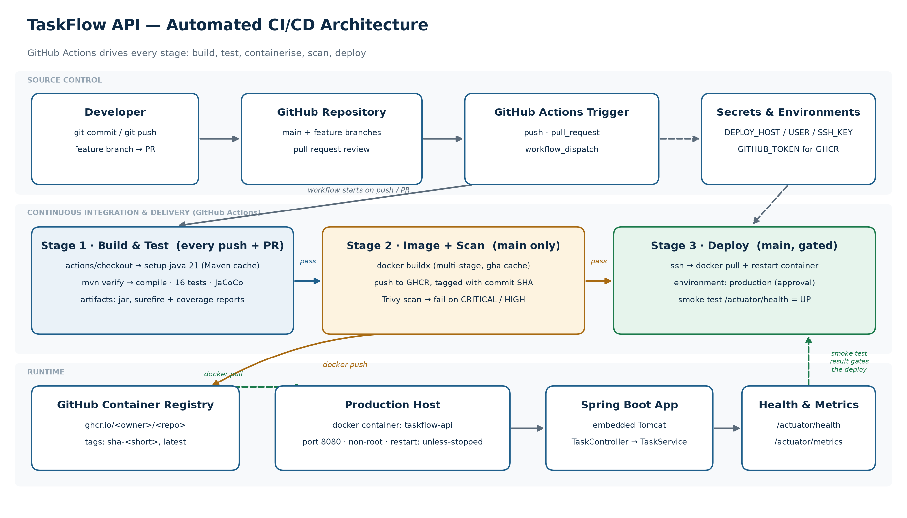

# TaskFlow API — Automated CI/CD Pipeline for a Java Spring Boot Application

A small but complete Spring Boot REST API, wired end to end into an automated
build → test → containerise → deploy pipeline on GitHub Actions.

The application is deliberately simple (a task list). The interesting part is
everything around it: the pipeline that builds, tests, scans and ships it on
every push, with no manual steps.

---

## What the pipeline does

| Stage | Trigger | What happens |
| --- | --- | --- |
| **Build & Test** | every push, every PR | JDK 21 set up, `mvn verify` compiles the code, runs all tests, produces the JaCoCo coverage report and a runnable jar. Reports are uploaded as build artifacts. |
| **Build & Scan Image** | push to `main` only | Multi-stage Docker build, image tagged with the commit SHA, pushed to GitHub Container Registry, then scanned by Trivy. A CRITICAL or HIGH finding fails the pipeline. |
| **Deploy** | push to `main`, after scan passes | SSH to the target host, pull the new image, restart the container, then smoke-test `/actuator/health` until it reports `UP`. |

A red build in stage 1 stops stages 2 and 3 — nothing is published or deployed
from code that does not compile or pass its tests.

Pull requests get a separate, faster check (`pull-request.yml`) that verifies the
build and proves the Dockerfile still builds, without pushing anything.

---

## Architecture



```
Developer ──git push──▶ GitHub repository ──▶ GitHub Actions
                                                  │
                              ┌───────────────────┼────────────────────┐
                              ▼                   ▼                    ▼
                       1. Build & Test      2. Image + Scan      3. Deploy
                       mvn verify           docker build         ssh + docker run
                       tests + coverage     push to GHCR         health check
                              │                   │                    │
                              └──── artifacts ────┴──▶ GHCR ──────────▶ Production host
                                                                       (container)
```

Inside the application:

```
HTTP ─▶ TaskController ─▶ TaskService ─▶ in-memory store
             │                  │
             ▼                  ▼
      ApiExceptionHandler   TaskNotFoundException
```

- **Controller** — HTTP only: routing, status codes, `Location` header.
- **Service** — business rules, IDs, timestamps, status transitions.
- **Domain** — immutable `Task` record plus a `TaskStatus` enum.
- **Error handling** — a single `@RestControllerAdvice` maps failures to RFC 7807
  `ProblemDetail` responses.

Keeping the storage behind the service means replacing the in-memory map with a
JPA repository later changes one class, not the controller or the tests.

---

## Technology stack

| Layer | Choice |
| --- | --- |
| Language | Java 21 |
| Framework | Spring Boot 3.3.5 (Web, Validation, Actuator) |
| Build | Maven 3.9 |
| Testing | JUnit 5, Mockito, AssertJ, MockMvc |
| Coverage | JaCoCo 0.8.12 |
| Version control | Git + GitHub |
| CI/CD | GitHub Actions |
| Container | Docker (multi-stage), Alpine JRE base |
| Registry | GitHub Container Registry (GHCR) |
| Image scanning | Trivy |

---

## API

Base path `/api/v1/tasks`.

| Method | Path | Purpose | Success |
| --- | --- | --- | --- |
| GET | `/api/v1/tasks?status=TODO` | List tasks, optional status filter | 200 |
| GET | `/api/v1/tasks/{id}` | Fetch one task | 200 / 404 |
| POST | `/api/v1/tasks` | Create a task | 201 + `Location` |
| PUT | `/api/v1/tasks/{id}` | Replace title, description, status | 200 / 404 |
| PATCH | `/api/v1/tasks/{id}/status?status=DONE` | Change status only | 200 / 404 |
| DELETE | `/api/v1/tasks/{id}` | Delete a task | 204 / 404 |

Operational endpoints: `GET /actuator/health`, `/actuator/info`, `/actuator/metrics`.

Example:

```bash
curl -X POST http://localhost:8080/api/v1/tasks \
  -H 'Content-Type: application/json' \
  -d '{"title":"Wire up CI","description":"GitHub Actions"}'
```

---

## Run it locally

Requires JDK 21 and Maven 3.9 (or Docker, if you prefer the container route).

```bash
# 1. Build and run the tests
mvn verify

# 2. Start the application
mvn spring-boot:run
# or run the packaged jar
java -jar target/taskflow-api.jar

# 3. Check it
curl http://localhost:8080/actuator/health
```

With Docker:

```bash
docker build -t taskflow-api:local .
docker run -p 8080:8080 taskflow-api:local

# or
docker compose up --build
```

---

## Deploying the pipeline to your own GitHub repository

1. Create a repository and push this project to it:

   ```bash
   git init
   git add .
   git commit -m "Initial commit: TaskFlow API with CI/CD pipeline"
   git branch -M main
   git remote add origin https://github.com/<your-user>/<your-repo>.git
   git push -u origin main
   ```

2. Add the deployment secrets under **Settings → Secrets and variables → Actions**:

   | Secret | Purpose |
   | --- | --- |
   | `DEPLOY_HOST` | Hostname or IP of the deployment target |
   | `DEPLOY_USER` | SSH user on that host |
   | `DEPLOY_SSH_KEY` | Private key for that user |

   `GITHUB_TOKEN` is provided automatically — no secret needed for GHCR.

3. Optional: create an environment called `production` under **Settings →
   Environments** and add required reviewers. The deploy job then waits for
   approval before it runs.

4. Push a change to `main` and watch the three stages run in the **Actions** tab.

If you do not have a deployment host yet, delete the `deploy` job — stages 1 and
2 still give you a complete, working CI pipeline with a published image.

---

## Project layout

```
taskflow-api/
├── .github/
│   ├── workflows/
│   │   ├── ci-cd.yml            # build → image → deploy
│   │   └── pull-request.yml     # PR verification
│   └── dependabot.yml           # weekly dependency updates
├── src/
│   ├── main/java/com/example/taskflow/
│   │   ├── TaskflowApplication.java
│   │   ├── domain/              # Task, TaskStatus
│   │   ├── service/             # TaskService, TaskNotFoundException
│   │   └── web/                 # TaskController, ApiExceptionHandler, dto/
│   ├── main/resources/application.yml
│   └── test/java/...            # unit, web-slice and full-context tests
├── Dockerfile                   # multi-stage build
├── docker-compose.yml
├── pom.xml
└── README.md
```

---

## Testing notes

Three layers of tests, 16 in total:

- `TaskServiceTest` — pure unit tests of the business rules, using a fixed clock
  so timestamp assertions are deterministic.
- `TaskControllerTest` — `@WebMvcTest` slice with a mocked service: status codes,
  JSON shape, `Location` header, validation failures, 404s.
- `TaskflowApplicationTests` — full context on a random port, driving the API over
  real HTTP, which is what proves the packaged jar boots.

`src/test/resources/mockito-extensions/org.mockito.plugins.MockMaker` selects
Mockito's subclass mock maker. The default inline mock maker attaches a bytecode
agent to the test JVM, which is blocked in locked-down containers. The subclass
maker avoids that; the trade-off is that final classes cannot be mocked, which
does not matter here.

Current state: **16 tests, 0 failures, 95.5% line coverage**.

---

## Design decisions worth knowing

- **Multi-stage Docker build.** Stage 1 uses a full Maven + JDK image to compile;
  stage 2 copies only the jar onto a slim Alpine JRE. The final image carries no
  build tooling or source code, which keeps it small and reduces the attack surface.
- **Non-root container user.** The runtime stage creates an `app` user and drops
  privileges before starting the JVM.
- **Dependency layer caching.** `pom.xml` is copied and `dependency:go-offline` runs
  before `src/` is copied, so routine code changes reuse the cached dependency layer.
- **Buildx layer caching in CI.** `cache-from/to: type=gha` keeps image builds fast
  across workflow runs.
- **Image tagged by commit SHA.** Every image is traceable back to the exact commit
  that produced it; `latest` is an additional tag, not the only one.
- **Health-gated deployment.** The deploy step polls `/actuator/health` and fails the
  workflow if the new container does not come up, so a bad release is visible
  immediately rather than the next morning.
